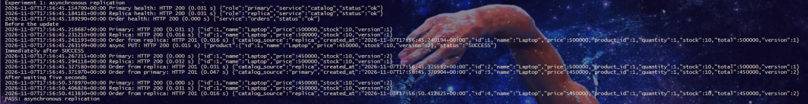
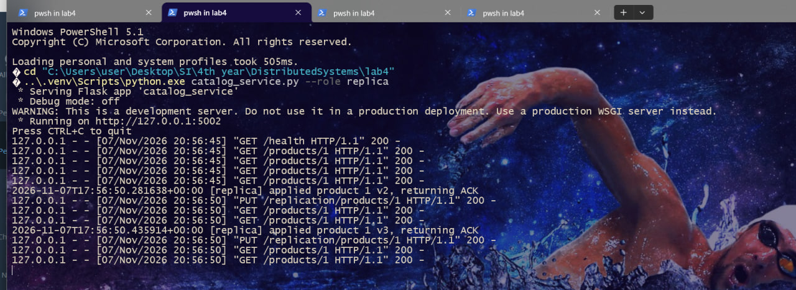
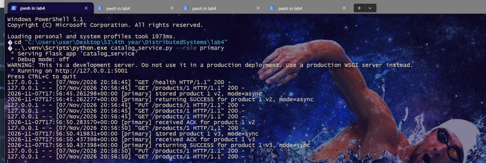
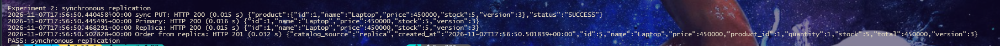

# Lab 4. Product Catalogue Replication

Two Catalog instances run as the Primary and the Replica. The Order Service reads product data from the selected instance over HTTP.

## Running the services

From the directory containing this README, run each command in a separate terminal.

| Process | Port | Command |
| --- | --- | --- |
| Catalog Primary | 5001 | `python catalog_service.py --role primary` |
| Catalog Replica | 5002 | `python catalog_service.py --role replica` |
| Order Service | 5003 | `python orders_service.py` |

Startup screenshots for all three services. [Primary on port 5001](screenshots/primary-startup.jpg), [Replica on port 5002](screenshots/replica-startup.jpg), [Order on port 5003](screenshots/order-startup.jpg).

In a fourth terminal, run `python demo.py`. The script checks the HTTP responses, prints product and order data, and waits five seconds before reading the product again in the asynchronous experiment. The Catalog terminals show when the Replica applies each version, when it sends `ACK`, and when the Primary returns `SUCCESS`.

The services store data in memory. Both catalogs start with a Laptop priced at 500000, with 10 units in stock and version 1. Restart all three processes before repeating the demo.

## Demo requests

| Action | HTTP request | JSON |
| --- | --- | --- |
| Read the product from the Primary | `GET http://127.0.0.1:5001/products/1` | |
| Read the product from the Replica | `GET http://127.0.0.1:5002/products/1` | |
| Update the price asynchronously | `PUT http://127.0.0.1:5001/products/1` | `{"price":450000,"mode":"async"}` |
| Create an order using the Replica | `POST http://127.0.0.1:5003/orders` | `{"product_id":1,"quantity":1,"catalog_source":"replica"}` |
| Update the stock synchronously | `PUT http://127.0.0.1:5001/products/1` | `{"stock":5,"mode":"sync"}` |

Set `"catalog_source":"primary"` to read from the Primary. The Order Service also uses the Primary by default. Each order records the product price, stock, and version returned by the selected catalog.

The Primary increments the product version under a lock and sends a full product snapshot to the Replica. The Replica ignores snapshots older than its current version. If synchronous delivery fails, the Primary returns HTTP 503 and keeps the version it wrote locally. The asynchronous timer makes one delivery attempt.

## Results

| Experiment and timing | Primary | Replica | Order reading from the Replica |
| --- | --- | --- | --- |
| Async, before the update | 500000, stock 10, v1 | 500000, stock 10, v1 | 500000, stock 10, v1 |
| Async, immediately after SUCCESS | 450000, stock 10, v2 | 500000, stock 10, v1 | 500000, stock 10, v1 |
| Async, after waiting five seconds | 450000, stock 10, v2 | 450000, stock 10, v2 | 450000, stock 10, v2 |
| Sync, after SUCCESS | 450000, stock 5, v3 | 450000, stock 5, v3 | 450000, stock 5, v3 |

### Asynchronous replication

Immediately after `SUCCESS`, the Primary shows a price of 450000 and version 2, while an order using the Replica still receives 500000 and version 1. After five seconds, a second order using the Replica receives 450000 and version 2.

### Synchronous replication

The Replica applied version 3 and sent `ACK`.

The Primary logged `received ACK for product 1 v3` before `returning SUCCESS for product 1 v3, mode=sync`.

After `SUCCESS`, both catalogs and the order using the Replica show 5 units in stock and version 3.

